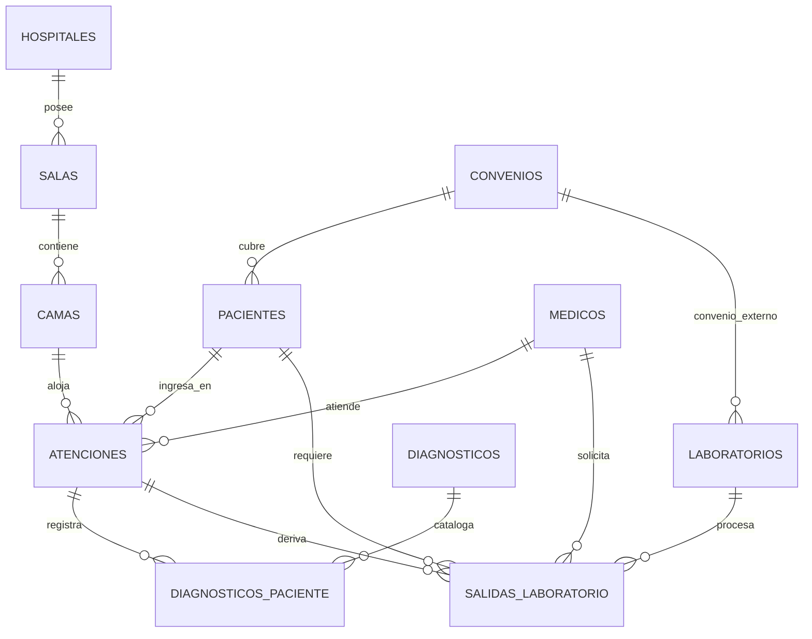

# Guía de Conexión y Documentación de Base de Datos MySQL

Este documento explica cómo conectar **HospitalSystem** a un servidor **MySQL 8.0+** (o compatible como MySQL en XAMPP / Docker), cómo cargar el esquema y los datos de prueba, y documenta el diseño relacional junto con todas sus funciones y procedimientos almacenados.

---

## 1. Requisitos Previos

- **MySQL Server 8.0+** en ejecución (puerto por defecto `3306`).
- Usuario con permisos para crear base de datos, tablas, vistas, funciones y procedimientos (por ejemplo `root` en entorno local de desarrollo).
- Si usas MySQL 8+ con `log_bin` habilitado y creas funciones sin `SUPER`, asegúrate de tener activo:
  ```sql
  SET GLOBAL log_bin_trust_function_creators = 1;
  ```

---

## 2. Formas de Inicializar la Base de Datos (`hospital_system_db`)

### Opción A: Automática desde la Aplicación WPF (Solo entorno de demostración)
1. Ejecuta `HospitalSystem.Desktop`.
2. En la pestaña **Resumen General**, ubica la tarjeta **Laboratorio de Conexión MySQL**.
3. Ajusta tu cadena de conexión (por ejemplo agrega tu contraseña en `Pwd=tu_clave;`):
   ```text
   Server=localhost;Port=3306;Database=hospital_system_db;Uid=root;Pwd=tu_clave;AllowUserVariables=True;
   ```
4. Haz clic en **Restablecer base de datos de demostración** y confirma el cuadro de advertencia.
   > **Advertencia**: `Database/schema.sql` utiliza `DROP TABLE IF EXISTS` para dejar un entorno limpio de pruebas, por lo que **destruye registros previos**. Para evolucionar el esquema sin perder datos, aplica migraciones incrementales no destructivas en `Database/migrations/` (como `001_schema_no_destructivo.sql`).
5. Haz clic en **Probar Conexión** en cualquier momento para verificar versión y disponibilidad.

### Opción B: Desde Terminal o MySQL Workbench
Ejecuta en orden los dos scripts ubicados en la carpeta `Database/`:

```powershell
mysql -u root -p < Database/schema.sql
mysql -u root -p < Database/seed.sql
```

---

## 3. Configuración Persistente de la Cadena de Conexión

Edita el archivo `HospitalSystem.Desktop/appsettings.json`:

```json
{
  "ConnectionStrings": {
    "HospitalMySql": "Server=localhost;Port=3306;Database=hospital_system_db;Uid=root;Pwd=TU_PASSWORD;AllowUserVariables=True;"
  }
}
```

> **Nota sobre `AllowUserVariables=True`**: `MySqlConnector` requiere este parámetro cuando invoca procedimientos almacenados con parámetros `OUT` (como `sp_registrar_ingreso_paciente`), aunque la clase `HospitalDataStore` también lo garantiza automáticamente en código.

Para la herramienta rápida de consola (`HospitalSystem.Console`), puedes definir la variable de entorno `HOSPITAL_MYSQL_CS`:

```powershell
$env:HOSPITAL_MYSQL_CS="Server=localhost;Port=3306;Database=hospital_system_db;Uid=root;Pwd=TU_PASSWORD;"
dotnet run --project HospitalSystem.Console
```

> **Modo Respaldo en Memoria**: Si MySQL está apagado al abrir la app, `HospitalRepository` conmuta de forma transparente a `HospitalDataStore` (en memoria con los mismos datos semilla) y lo notifica en barra de estado para que nunca bloquee la interfaz mientras ajustas tus credenciales.

---

## 4. Diseño Relacional de la Base de Datos

El esquema consta de **11 tablas** en motor `InnoDB` con codificación `utf8mb4_unicode_ci`:



### Resumen de Tablas

| Tabla | Responsabilidad Principal |
| :--- | :--- |
| `hospitales` | Datos institucionales y código de habilitación sanitaria del hospital. |
| `convenios` | Aseguradoras, previsión pública/privada y convenios externos con su porcentaje de cobertura. |
| `salas` | Salas operativas del hospital (`Urgencias`, `Observación`, `Medicina Interna`, `Pediatría`, `UCI`) y piso. |
| `camas` | Inventario individual de camas por sala con estado `ocupada` (`0` libre, `1` ocupada) e índice de disponibilidad. |
| `medicos` | Plantilla médica con matrícula profesional, especialidad, turno, consultorio y bandera `en_guardia_hoy` (**Médicos del Día**). |
| `pacientes` | Registro único por `cedula`, con `nombres`, `sexo`, `sintomas_actuales` obligatorios y convenio asociado. |
| `diagnosticos` | Catálogo clínico estandarizado por código CIE-10. |
| `atenciones` | Episodio clínico de ingreso del paciente con médico tratante, cama opcional, síntomas y estado (`EnAtencion`, `EnLaboratorio`, `AltaMedica`). |
| `diagnosticos_paciente` | Relación entre atención/paciente y los diagnósticos CIE-10 presuntivos o confirmados. |
| `laboratorios` | Unidades de diagnóstico internas (Hematología, Imagenología, Microbiología) y externas por convenio. |
| `salidas_laboratorio` | Trazabilidad de salidas de pacientes a laboratorios cuando su cuadro clínico lo requiere, incluyendo prioridad, estado y resumen de resultados. |

---

## 5. Documentación de Funciones, Procedimientos y Vistas MySQL

El archivo `Database/schema.sql` implementa lógica directamente en el motor MySQL para validar el comportamiento de funciones y transacciones desde .NET:

### Funciones Almacenadas (`FUNCTION`)

1. **`fn_camas_disponibles() RETURNS INT`**
   - **Propósito**: Devuelve el número exacto de camas libres (`c.ocupada = 0`) que pertenecen a salas activas (`s.activa = 1`).
   - **Dónde se usa**: En la vista `vw_indicadores_hospital` para alimentar el indicador principal de **Camas Disponibles**.

2. **`fn_total_salas_activas() RETURNS INT`**
   - **Propósito**: Cuenta la cantidad total de salas operativas habilitadas en el hospital (`activa = 1`).
   - **Dónde se usa**: En `vw_indicadores_hospital` para mostrar la **Cantidad de Salas**.

3. **`fn_medicos_del_dia() RETURNS INT`**
   - **Propósito**: Calcula cuántos médicos activos tienen asignada la guardia del día (`activo = 1 AND en_guardia_hoy = 1`).
   - **Dónde se usa**: En `vw_indicadores_hospital` para el KPI de **Médicos del Día**.

4. **`fn_ocupacion_sala_pct(p_sala_id INT) RETURNS DECIMAL(5,2)`**
   - **Propósito**: Recibe el `id` de una sala y retorna su porcentaje de ocupación de camas redondeado a 2 decimales (`0.00` si no posee camas).
   - **Dónde se usa**: En `HospitalRepository.ObtenerSalasResumenAsync()` al listar cada sala en el panel principal.

5. **`fn_paciente_tiene_salida_activa(p_paciente_id INT) RETURNS TINYINT(1)`**
   - **Propósito**: Evalúa si un paciente mantiene al menos una orden en `salidas_laboratorio` con estado `PendienteSalida` o `EnLaboratorio`. Retorna `1` (sí) o `0` (no).
   - **Dónde se usa**: En el listado del **Menú Pacientes** y al procesar el retorno del paciente desde laboratorio (`CompletarSalidaLaboratorioAsync`) para restaurar su atención a `EnAtencion` cuando ya no quedan estudios pendientes.

### Procedimientos Almacenados (`PROCEDURE`)

1. **`sp_registrar_ingreso_paciente(...)`**
   - **Parámetros**: `IN` (`p_cedula`, `p_nombres`, `p_sexo`, `p_sintomas`, `p_convenio_id`, `p_medico_id`, `p_cama_id`, `p_requiere_lab`, `p_laboratorio_id`, `p_examen_lab`, `p_prioridad_lab`) y `OUT` (`p_paciente_id`, `p_atencion_id`).
   - **Propósito**: Ejecuta dentro de una transacción (`START TRANSACTION` / `COMMIT` con `EXIT HANDLER` para `ROLLBACK` ante error):
     1. Inserta el paciente o actualiza sus datos/síntomas si la `cedula` ya existía (`ON DUPLICATE KEY UPDATE`).
    2. Ejecuta `UPDATE camas SET ocupada = 1 WHERE id = p_cama_id AND ocupada = 0` y comprueba `ROW_COUNT() <> 1`; si la cama ya estaba ocupada o no existe, lanza `SIGNAL SQLSTATE '45000'` provocando `ROLLBACK` inmediato.
    3. Crea el registro en `atenciones`.
    4. Si el paciente requiere salida inmediata a laboratorio (`p_requiere_lab = 1`), inserta automáticamente el registro en `salidas_laboratorio` y coloca la atención en estado `EnLaboratorio`.

2. **`sp_dar_alta_atencion(IN p_atencion_id INT)`**
   - **Propósito**: Bloquea la fila con `SELECT ... FOR UPDATE`, rechaza con `SIGNAL SQLSTATE '45000'` atenciones inexistentes o que ya tengan `AltaMedica`, actualiza el egreso verificando `ROW_COUNT() = 1` y libera la cama únicamente si ninguna otra atención activa posterior la tiene asignada (`NOT EXISTS`).

### Vista Consolidada (`VIEW`)

- **`vw_indicadores_hospital`**
  - Expone en una sola consulta `camas_disponibles`, `camas_totales`, `cantidad_salas`, `medicos_del_dia`, `pacientes_activos` y `salidas_laboratorio_activas` combinando las funciones anteriores.
